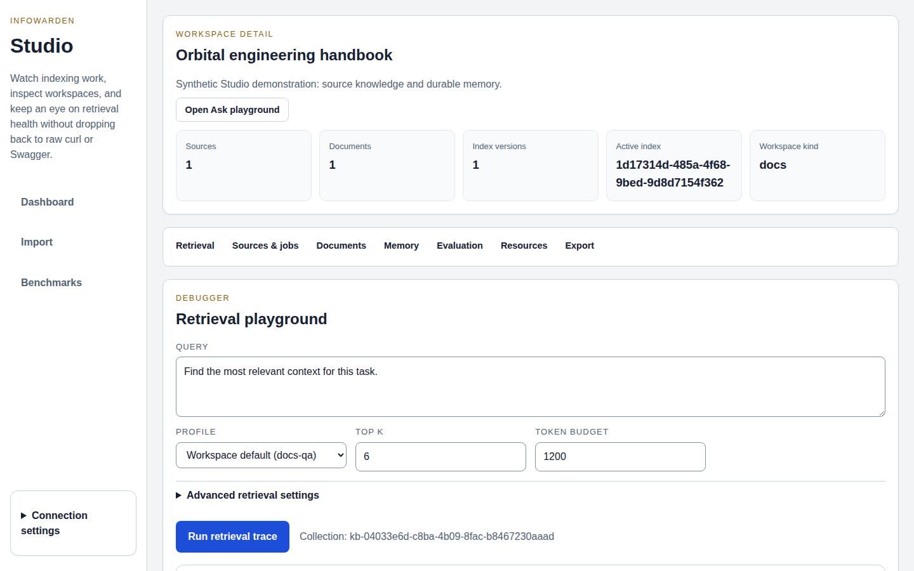
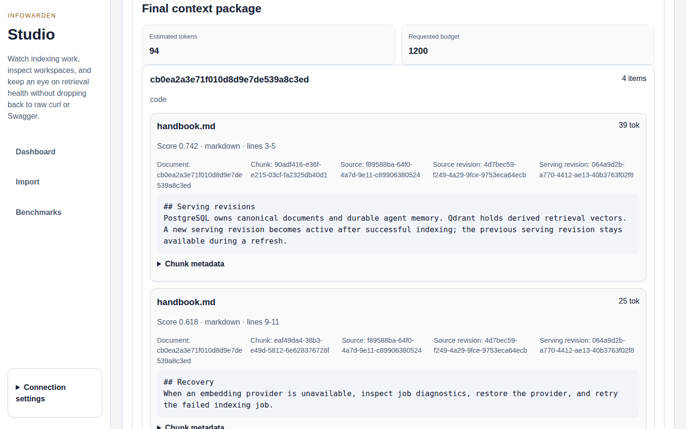
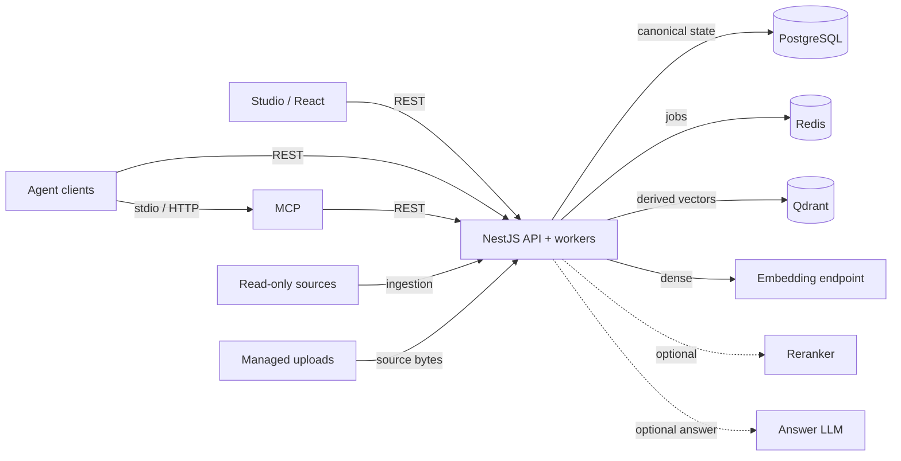
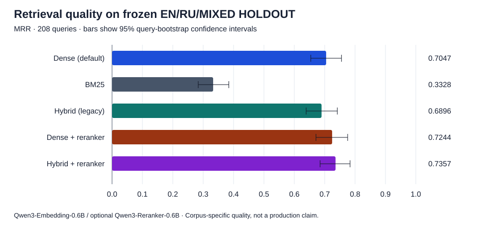
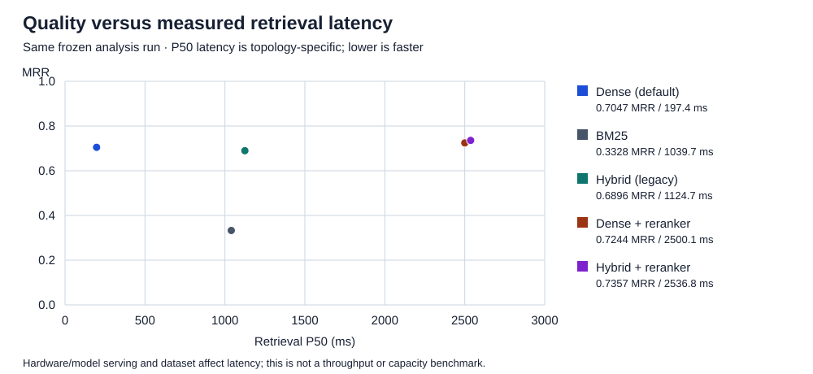

# InfoWarden

**A self-hosted retrieval, context, and durable-memory foundation for AI agents.**
Developed as a reusable engineering project and technology demonstrator.


[](LICENSE)



## Persistent knowledge, inspectable context

An agent's working context is temporary. Project documentation, reference archives,
decisions and deliberately written memory need a durable home with clear provenance.
InfoWarden imports those sources into isolated workspaces, tracks revisions, and
returns a bounded context package through REST or MCP. Your agent can use its own
model to reason over that package; an answer LLM inside InfoWarden is optional.

One deployment serves many workspaces. A workspace groups sources and owns its
retrieval settings, serving revision and durable memory.

## Implemented capabilities

- **Versioned knowledge:** read-only folders, Obsidian vaults, Git and bounded URLs;
  managed file/ZIP uploads, text-layer PDF, DOCX and HTML extraction.
- **Retrieval:** dense, PostgreSQL BM25, hybrid fusion and optional reranking;
  metadata filters, deduplication, neighbor expansion and hard context budgets.
- **Provenance:** document paths, source revisions and serving identities in
  results; Studio traces expose candidate stages and the final context package.
- **Durable memory:** client-written facts, decisions and session summaries,
  separate from indexed source knowledge.
- **Operations:** incremental refresh, indexing diagnostics, evaluation and
  explicit rebuild/move controls for derived vector indexes.
- **Agent integration:** REST and MCP with read, agent and operator capability profiles.



## Architecture

PostgreSQL is canonical state. Managed uploads preserve imported source bytes.
Qdrant is a rebuildable vector index; Redis coordinates jobs. The API process
also hosts workers. Dashed arrows below identify optional providers.

<!-- runtime-diagram:start -->



<!-- runtime-diagram:end -->

See [runtime ownership, ingestion lifecycle and retrieval flow](guide/architecture.md).

## Quickstart

Requires Node 22–24, pnpm 10.30.3, Bash and Docker Compose v2 with Docker running.
Use Linux/macOS or WSL2; plan for 4 CPU cores, 8 GB RAM and several GB of disk.
Initial image/model downloads need Internet access.

```bash
git clone https://github.com/HaidaDaniel/infowarden.git
cd infowarden
pnpm install --frozen-lockfile
pnpm prisma:generate
pnpm demo
```

The isolated CPU demo indexes synthetic fixtures, checks retrieval provenance,
refreshes source content and exercises MCP, then cleans up its services.
For a persistent local Studio session:

```bash
cp .env.example .env
# Review local configuration before starting.
pnpm dev:cpu
```

Follow the printed Studio/API URLs. Development defaults disable authentication
and are for local use. [Deployment instructions](guide/deployment.md) explain
provider configuration, credentials, TLS ingress and backups.

## From source to useful context

1. Open **Import**, create a workspace and upload a synthetic document or ZIP.
2. Follow its indexing job; inspect failures before retrying from **Sources & jobs**.
3. Run a retrieval trace. Start with **Recommended — Dense**; compare Lexical or Hybrid.
4. Inspect the final context, source path and active serving revision before using it.
5. Save a fact or decision deliberately under **Memory**. Refresh sources separately
   when their underlying knowledge changes.

[Source management](assets/screenshots/source-management.png) and
[durable memory](assets/screenshots/durable-memory.png) show real synthetic data.
All four screenshots are native 1440×900 browser captures; see
[capture provenance](assets/screenshots/provenance.json).

## Frozen retrieval evidence

The benchmark has 520 EN/RU/MIXED queries: 312 DEV and 208 HOLDOUT. The table
and charts below use the same frozen v2.1 analysis, with three repetitions.
These are corpus/model-specific retrieval results, not production capacity or
demonstrated coding-agent productivity.

<!-- benchmark-table:start -->

| Mode              | Hit@10 | MRR    | P50 (ms) | P95 (ms) |
| ----------------- | ------ | ------ | -------- | -------- |
| Dense (default)   | 93.8%  | 0.7047 | 197      | 248      |
| BM25              | 71.2%  | 0.3328 | 1040     | 2178     |
| Hybrid (legacy)   | 94.2%  | 0.6896 | 1125     | 2335     |
| Dense + reranker  | 88.9%  | 0.7244 | 2500     | 3019     |
| Hybrid + reranker | 91.8%  | 0.7357 | 2537     | 3141     |

<!-- benchmark-table:end -->



Dense is the default because it combines higher measured MRR than the selected
BM25/legacy hybrid baselines with lower measured latency. Hybrid remains available;
its slightly higher Hit@10 does not make it universally better. Reranking improves
MRR in these runs at substantial latency cost and can reduce Hit@10; it is opt-in.
Lexical reranking is unsupported after a harmful measured pairing.



Quality used **Qwen3-Embedding-0.6B, 1,024 dimensions**, and optional
**Qwen3-Reranker-0.6B**. The CPU demo uses BAAI/bge-small-en-v1.5, 384 dimensions,
and does not reproduce those quality numbers. Latency depends on hardware, model
serving and topology; the evidence does not provide a portable hardware/capacity
guarantee. Confidence intervals describe query sampling, not production SLOs.

Read the [methodology, partition results and caveats](guide/benchmarks.md),
[frozen analysis](fixtures/eval/benchmark-v2/reports/v2.1-analysis/report.md) and
[machine-readable chart data](assets/benchmarks/data.json).

## REST and MCP

Swagger at `/api/docs` and `/api/docs-json` describes the running REST API.
For a configured local workspace:

```bash
curl -sS http://localhost:3000/workspaces
curl -sS -X POST http://localhost:3000/workspaces/your-workspace-slug/context-package \
  -H 'Content-Type: application/json' \
  -d '{"query":"How are serving revisions activated?","profileKey":"default","topK":5}'
```

Add your operator-provided `x-api-key` header when API authentication is enabled.
The MCP adapter defaults to the compact, read-only `read` profile, including
`retrieve_context`, `read_document`, `search_memory` and `list_workspaces`.
Use `agent` for deliberate memory writes and reserve `operator` for administration.
See [interfaces](guide/interfaces.md) and integration examples for
[OpenCode HTTP](examples/integrations/opencode-http.jsonc),
[OpenCode stdio](examples/integrations/opencode-stdio.jsonc) and
[Hermes](examples/integrations/hermes-config.yaml).

## Design decisions and limitations

- Canonical state and source bytes are backed up together; derived vector indexes
  can be rebuilt. One active placement per workspace is not HA replication.
- Lexical queries make no embedding call; ingestion still requires dense indexing.
- Optional `rag_answer` performs one bounded provider-backed synthesis with citation
  checks. Memory contains client-written content, not automatic session summaries.
- Shared API key authentication is the implemented access boundary. RBAC, HA and
  production SLOs are not established. Treat deployment examples as starting points.
- Studio supports memory creation/search; editing remains available through API/MCP.
- RLM, generated indexing artifacts, neural sparse/late interaction retrieval,
  code graphs/LSP and OCR/audio/video remain deferred. Coding-agent productivity
  is unproven; no enterprise-scale or superiority-over-native-tools claim is made.

## Documentation and contribution

[Architecture](guide/architecture.md) · [Interfaces](guide/interfaces.md) ·
[Deployment](guide/deployment.md) · [Benchmarks](guide/benchmarks.md) ·
[Fixture provenance](guide/fixtures.md) · [Changelog](CHANGELOG.md)

MIT licensed. See [LICENSE](LICENSE), [CONTRIBUTING](CONTRIBUTING.md) and
[SECURITY](SECURITY.md).
