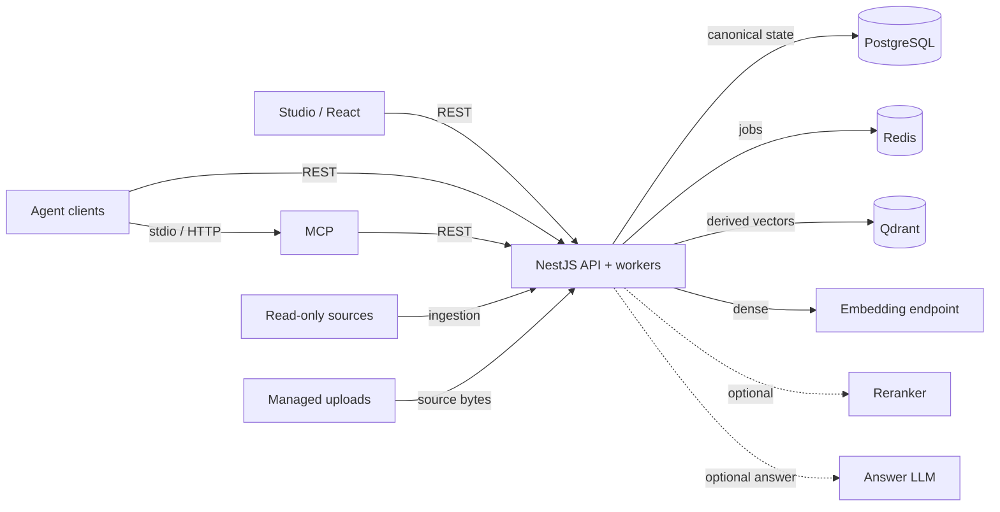
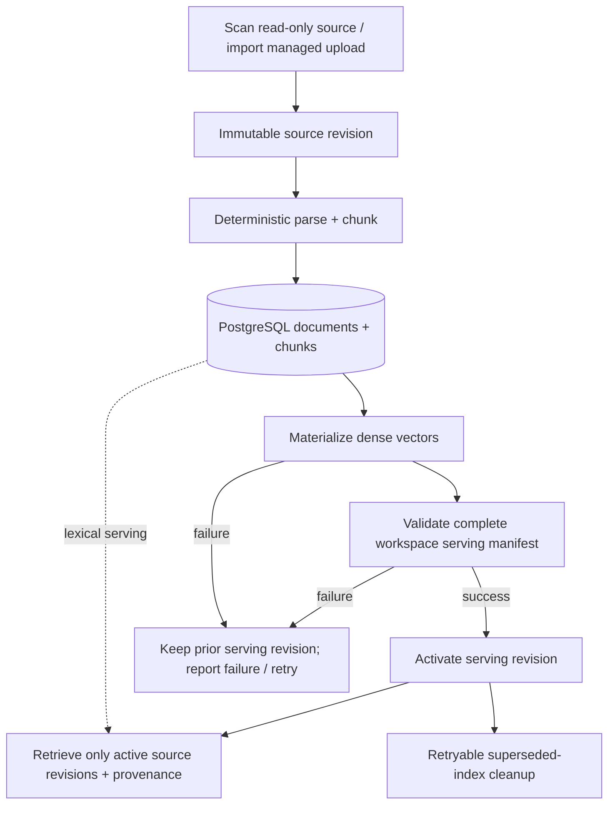
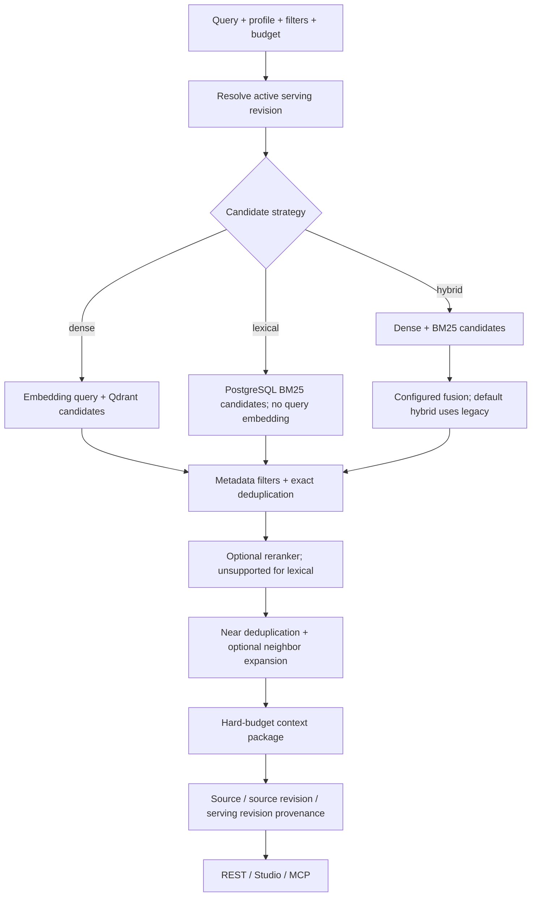

# Runtime architecture and data ownership

InfoWarden is a modular NestJS API with React Studio and an MCP adapter.
The API process hosts BullMQ workers. One deployment serves many workspaces;
each workspace groups versioned sources and deliberately written durable memory.
Solid labeled arrows show requests or data access; dashed arrows identify optional
provider calls. These services are implemented; the diagram does not imply HA.

## Runtime components

PostgreSQL preserves workspace, source revision, document/chunk, serving-manifest, evaluation and durable-memory state. Redis coordinates jobs. Qdrant is derived vector serving state; PostgreSQL lexical serving uses canonical chunks. External sources stay read-only. Managed upload bytes are operator-owned storage. Back up PostgreSQL and managed uploads together.

[Diagram source](../assets/diagrams/runtime.mmd) · [Rendered SVG](../assets/diagrams/runtime.svg)

## Ingestion and serving lifecycle

Source changes create immutable revisions; deterministic parsing/chunking and dense materialization precede serving validation. A successful refresh activates a complete workspace source-revision manifest. On failure, an existing serving revision is retained; initial ingestion has no prior revision to fall back to. Deleted content leaves active serving after successful refresh. Rebuild/move operations may use candidate collections; one active Qdrant placement per workspace is not replication.

[Diagram source](../assets/diagrams/lifecycle.mmd) · [Rendered SVG](../assets/diagrams/lifecycle.svg)

## Retrieval request flow

Requests resolve one active serving revision and preserve its provenance. Lexical queries avoid both query embeddings and Qdrant placement, but dense indexing remains an ingestion prerequisite. Metadata filtering and exact deduplication precede optional reranking; near-duplicate suppression and neighbor expansion precede budget packaging. Lexical reranking is unsupported. REST, Studio, evaluation and MCP reuse this backend pipeline.

[Diagram source](../assets/diagrams/retrieval.mmd) · [Rendered SVG](../assets/diagrams/retrieval.svg)

## Optional answers and durable memory

`rag_answer` performs at most one bounded provider-backed synthesis call with
citation validation. An answer LLM is not required for retrieval. Durable memory
is explicitly written by clients, separate from source knowledge; session
summaries are not invented automatically. Studio supports creation/search;
API/MCP support updates and archive operations.

These capabilities do not establish production SLOs, enterprise readiness or
coding-agent productivity. See [interfaces](interfaces.md), [deployment](deployment.md),
[benchmarks](benchmarks.md), [presentation reproducibility](presentation.md) and
[security](../SECURITY.md).
